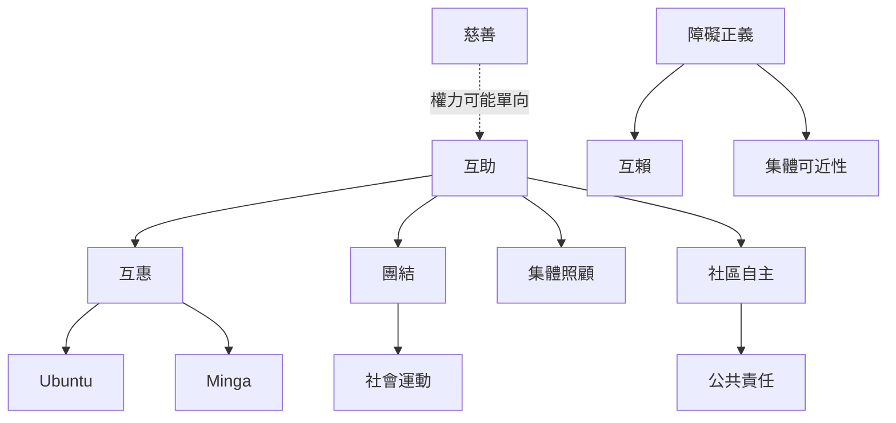

互助的倫理核心不只是提供幫助，而是承認相互依存、共同定義需求並共享決策權。此地圖把互助、互惠、團結、慈善、障礙正義與公共責任放在一起，供比較互助的倫理和政治形式。

## 思與行
互助要問「我們如何一起活下去」，而不是只問「誰有能力幫助誰」。互助實踐必須同時處理尊嚴、權力、分配公平與制度責任。

## 參考

**概念連結**：[[互助]]、[[互惠]]、[[團結]]、[[慈善]]、[[互賴]]、[[集體照顧]]、[[障礙正義]]、[[集體可近性]]、[[社區自主]]

**核心筆記**：[[互助不只是善意而是共同生存的社會能力]]、[[互助與慈善的差別在於權力與關係是否對等]]、[[互助不能只補救匱乏也要追問匱乏如何被製造]]、[[互惠不等於即時等量交換]]

**重要文獻**：[[團結而非慈善把互助連結到社會運動與生存需求]]、[[疫情期間互助的核心價值包括互惠共同人性與社區主導照顧]]、[[障礙正義把互賴與集體可近性列為解放的核心原則]]
