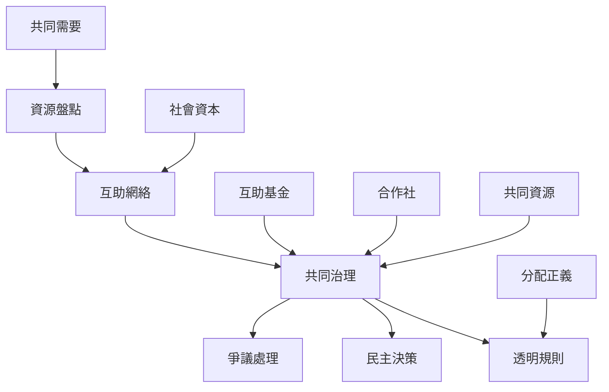

互助可以以非正式小組、互助基金、互助會、合作社、社區組織或共同資源治理的形式存在。此地圖聚焦如何將善意轉化為可持續、公平且能修訂的組織制度。

## 思與行
互助組織必須在信任與規則之間取得平衡：規則不是為了消滅信任，而是讓信任不依賴少數人的記憶、魅力或無償付出。

## 參考

**概念連結**：[[互助]]、[[共同治理]]、[[共同資源]]、[[合作社]]、[[互助會]]、[[社會資本]]、[[水平組織]]、[[分配正義]]、[[社區網絡]]、[[團結經濟]]

**核心筆記**：[[共同資源治理需要社群制定可修訂的規則]]、[[互助網絡的信任需要透明規則與公平分配共同支撐]]、[[社會資本只有跨越熟人圈才可能擴大互助的公平性]]、[[合作社能把互助轉化為民主控制的經濟制度]]

**重要文獻**：[[公共資源可以透過社群自我治理而不必只依賴市場或國家]]、[[合作社原則提供民主治理互助經濟的制度參考]]、[[南非 Stokvel 讓女性透過輪轉儲蓄建立非正式金融支持]]
