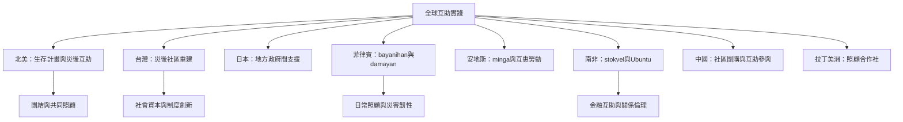

全球各地互助實踐有不同歷史與語言：南非的 stokvel、安地斯的 minga、菲律賓的 bayanihan 與 damayan、南部非洲的 Ubuntu 倫理、台灣九二一災後社區重建，以及北美的社區生存計畫與食物共享。此地圖強調比較而非把地方差異化約為單一普遍模式。

## 思與行
在地概念要回到具體社群和歷史脈絡理解。比較的目的不是將它們變成可任意複製的工具，而是辨認互助實踐如何回應不同的資源條件、制度關係與權力結構。

## 參考

**概念連結**：[[Minga]]、[[Bayanihan]]、[[Ubuntu]]、[[Stokvel]]、[[互助]]、[[互惠]]、[[團結經濟]]、[[災害韌性]]

**核心筆記**：[[地方互助知識不能脫離土地歷史與權力脈絡]]、[[互助網絡的信任需要透明規則與公平分配共同支撐]]、[[互助不等於政府替代品而是公共責任的協作方式]]

**重要文獻**：[[厄瓜多原住民族的互惠勞動顯示交換制度深植於地方生計]]、[[安地斯的 Minga 不是單一固定形式而是多樣的共同勞動]]、[[南非 Stokvel 讓女性透過輪轉儲蓄建立非正式金融支持]]、[[菲律賓的 Damayan 與 Bayanihan 支撐日常生存與災害韌性]]、[[台灣九二一震後重建顯示信任與網絡需要長期培養]]
