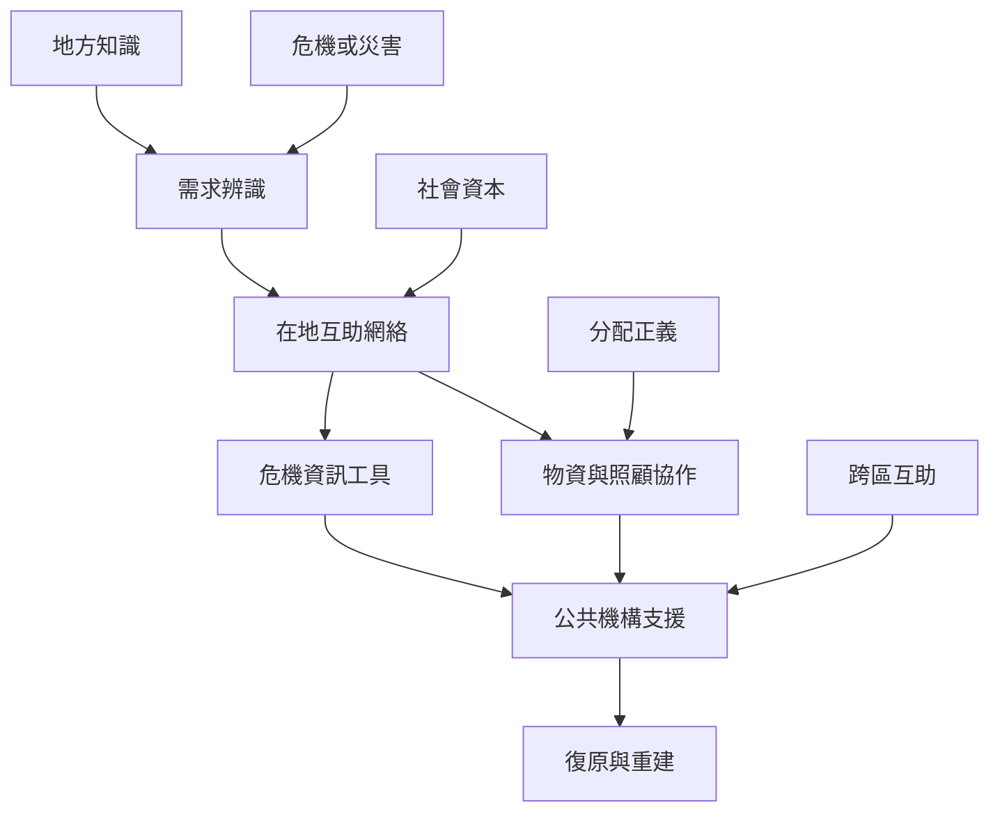

災害與疫情會加劇物資、照顧與資訊需求，也讓平時存在的關係網絡變得可見。此地圖連接地方互助、危機資訊、災後重建、跨地域支援與公共制度。

## 思與行
韌性不是要求社區自己承擔所有風險，而是建立能在地方知識、民間互助、公共服務與跨區支援之間流動的多層次網絡。

## 參考

**概念連結**：[[災害韌性]]、[[社區網絡]]、[[社會資本]]、[[危機資訊學]]、[[互助]]、[[社區自主]]、[[分配正義]]、[[共同治理]]

**核心筆記**：[[災害韌性不是自立神話而是多層次互賴網絡]]、[[互助不等於政府替代品而是公共責任的協作方式]]、[[數位工具能擴大互助網絡但不能取代信任]]

**重要文獻**：[[佔領桑迪展示災後自發團體的快速動員與物流能力]]、[[台灣九二一震後重建顯示信任與網絡需要長期培養]]、[[菲律賓的 Damayan 與 Bayanihan 支撐日常生存與災害韌性]]、[[食物共享櫃能改善取得食物的機會但仍受可及性與品質限制]]
