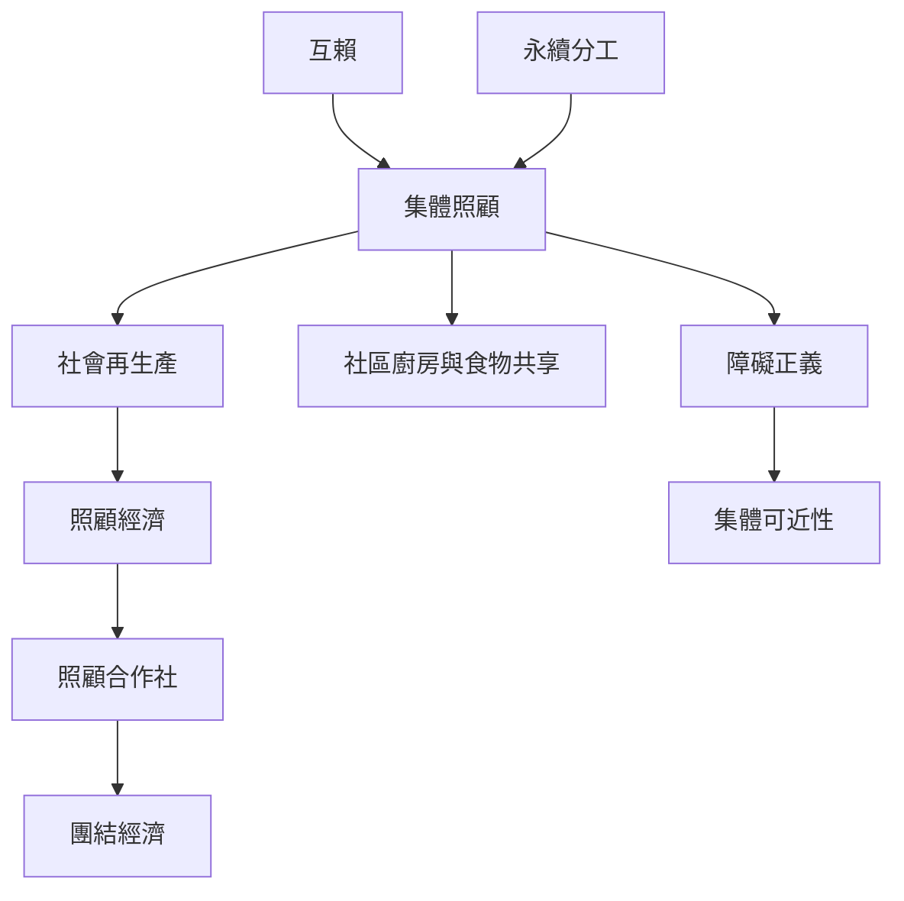

日常互助常發生在煮食、清潔、陪伴、交通、兒童照顧、長者支持、健康與知識交換等生活維持工作中。此地圖從女性主義經濟學、障礙正義與合作社研究理解這些工作如何被看見、分配與維持。

## 思與行
若互助依賴無償照顧，必須追問誰承擔時間與情緒成本。真正的共同照顧包含工作者的尊嚴、報酬與休息，也包含使用者的選擇權。

## 參考

**概念連結**：[[互賴]]、[[集體照顧]]、[[社會再生產]]、[[照顧經濟]]、[[集體可近性]]、[[障礙正義]]、[[合作社]]、[[團結經濟]]

**核心筆記**：[[互助的永續取決於照顧照顧者與分攤隱形勞動]]、[[集體可近性應在互助活動設計之初就被納入]]、[[食物共享能把互助從緊急救濟延伸為日常公共基礎設施]]

**重要文獻**：[[拉丁美洲照顧合作社提供女性主導的共同工作案例]]、[[國際勞工組織指出合作社能改善拉丁美洲照顧工作的條件]]、[[照顧經濟研究把無償照顧視為社會基礎而非經濟邊角]]
