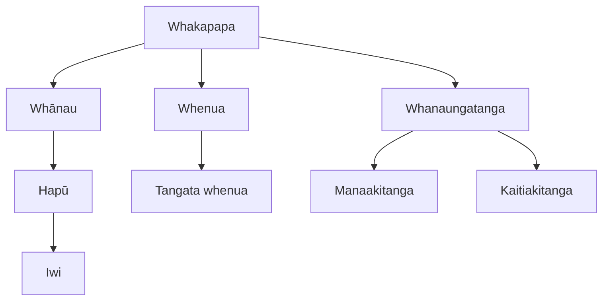

Māori 社會關係不是只有個人與家庭，而是透過 whakapapa 連結 whānau、hapū、iwi、地方與其他生命。關係帶出身份，也帶出權利、互惠與責任。閱讀順序可由 [[Whakapapa]] 開始，再讀 [[Whanaungatanga]]、[[Whānau]]、[[Hapū]]、[[Iwi]] 與 [[Tangata_whenua]]。

關係不等於固定階層：各 iwi、hapū 的歷史、政治安排與當代組織形式需要分別理解。
