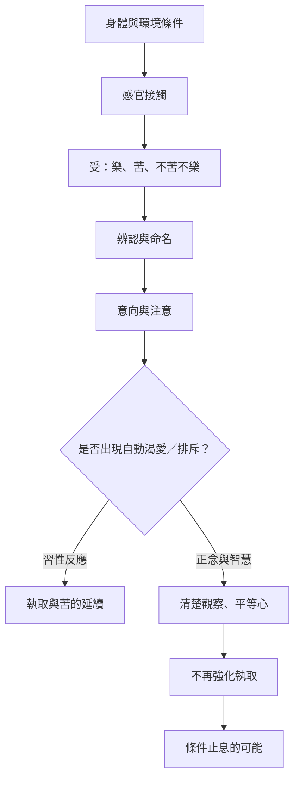

名色分析可以轉化為日常觀察：先辨識色法特性，再觀察名法如何感受、辨認、意向、接觸及注意；進一步追蹤識與名色如何互依，觸如何成為受的條件，以及受如何在無明與渴愛支持下轉成執取。日常實踐不是追求特殊境界，而是清楚看見經驗依條件形成。

概念連結：[[名色分別削弱把身心經驗認作固定自我]]、[[理解名色必須同時理解其生起與止息]]、[[受是接觸後被經驗到的感受調性]]、[[把行走中的每一步當成觀察名色互依的微型實驗]]、[[先辨識身體感受再命名情緒能減少自動反應]]。

## 思與行
* 每天選一段步行或靜坐，練習分辨身體特性、感受、辨認與意向。
* 若觀察帶來不適，回到自然呼吸與日常活動，不強迫身心，也不把某種經驗當作必須達成的成果。

全書導讀：[[Namarupa]]。
