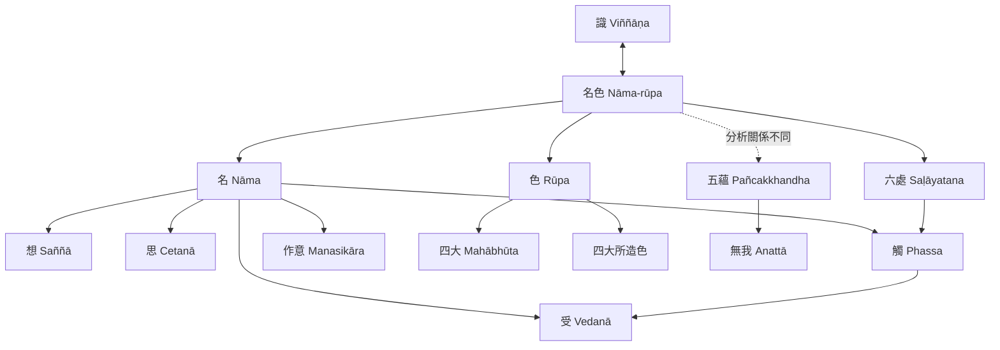

本地圖以早期經典的操作性定義為中心：名是受、想、思、觸、作意；色是四大及四大所造色。識與名色互為條件，並共同支持六處、觸與受。五蘊、四大、無我等概念提供不同角度，不能互相簡化成同義詞。

概念連結：[[名色（Nāma-rūpa）]]、[[名（Nāma）]]、[[色（Rūpa）]]、[[識（Viññāṇa）]]、[[五蘊（Pañcakkhandha）]]、[[四大（Mahābhūta）]]、[[受（Vedanā）]]、[[想（Saññā）]]、[[觸（Phassa）]]、[[作意（Manasikāra）]]、[[六處（Saḷāyatana）]]、[[無我（Anattā）]]。

## 思與行
* 讀 SN 12.2 後，嘗試不看圖重畫一次，確認每個名法與色法的定義。
* 再比較[[不同佛教傳統對名色支有不同分析層次]]，避免把本圖當成所有時代的唯一系統。

全書導讀：[[Namarupa]]。
