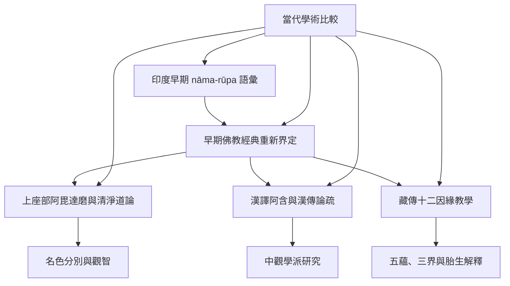

名色的歷史語義與教義功能，需放在不同時代、文本與傳承中比較。早期印度語境的「名與形」可描述辨識世界的方式；早期佛教經典把名拆為心理功能、色拆為物質條件；上座部論書發展出名色分辨的修行分析；漢傳與藏傳文獻常連結五蘊、胎生及十二因緣支位；中觀研究則提醒這些解釋有其論典脈絡。

概念連結：[[名色是歷史語境中的多義術語而非固定翻譯]]、[[不同佛教傳統對名色支有不同分析層次]]、[[名色分別（Nāmarūpa-vavatthāna）]]與[[名色（Nāma-rūpa）]]。

## 思與行
* 每次新增資料，都註明它屬於哪個傳統、哪個時期、哪種解釋層次。
* 把詞彙相同與理論相同分開，不從梵語拼寫相同直接推定義理一致。

全書導讀：[[Namarupa]]。
