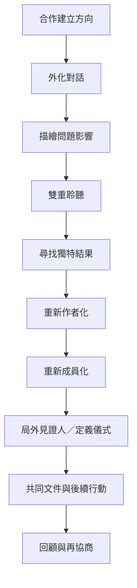

本地圖聚焦從問題描述到偏好故事的會談歷程。這些實踐不是固定流程，也不是每次都要全部使用；治療師應依當事人偏好、文化脈絡與安全需求調整。可從 [[外化對話]]、[[雙重聆聽]]、[[獨特結果]]、[[重新作者化]] 開始，再視需要連結 [[重新成員化]]、[[定義儀式]]、[[局外見證人]] 與 [[治療性文件]]。

實踐卡：[[外化對話把問題與人的身份區分開來]]、[[重新作者化要從例外事件找到價值與能動性]]、[[偏好故事需要被見證才能獲得社會厚度]]、[[治療性文件將對話延伸到會談之外]]。
