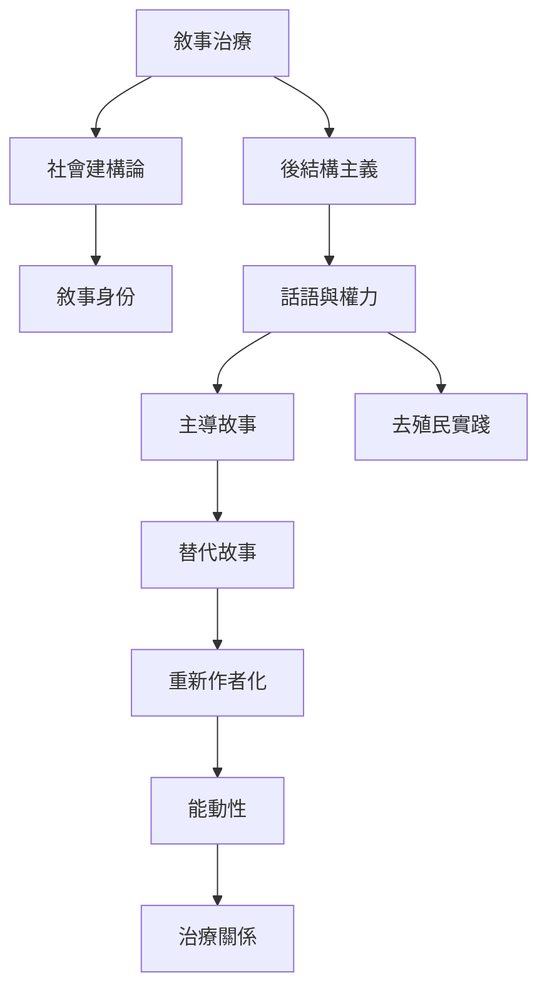

本地圖整理敘事治療如何從社會建構論、後結構主義與權力分析理解身份。理論主線不是「用故事替代事實」，而是檢視故事如何選擇經驗、構成身份，並讓某些知識與聲音得到或失去位置。閱讀時可同時參照 [[主導故事]]、[[替代故事]]、[[敘事身份]]、[[話語與權力]]、[[能動性]]。

可延伸閱讀：[[敘事治療的源流連結澳洲紐西蘭家庭治療與後結構思想]]、[[敘事治療的能動性承諾與傅柯權力分析之間存在理論張力]]、[[跨文化實踐要讓地方知識共同塑造框架]]。
