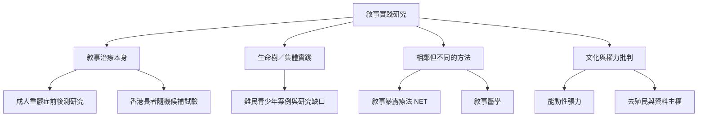

本地圖將研究證據拆成不同層級：個別臨床研究、隨機對照試驗、系統性回顧、質性研究、實務案例與理論批判。不能把這些證據視為同一層次，也不能把所有含有 narrative 一字的方法混為一談。優先參照 [[證據解讀需區分學派與介入類型]]。

重點證據：[[成人重鬱症敘事治療研究呈現初步但有限的療效訊號]]、[[香港長者生命樹團體試驗顯示生命智慧可被重新辨認]]、[[香港二十年敘事治療文獻回顧指出在地共研仍有空間]]、[[生命樹在難民青少年創傷工作中的研究證據仍不足]]、[[敘事暴露療法的實證結果不能直接算作敘事治療的證據]]。
