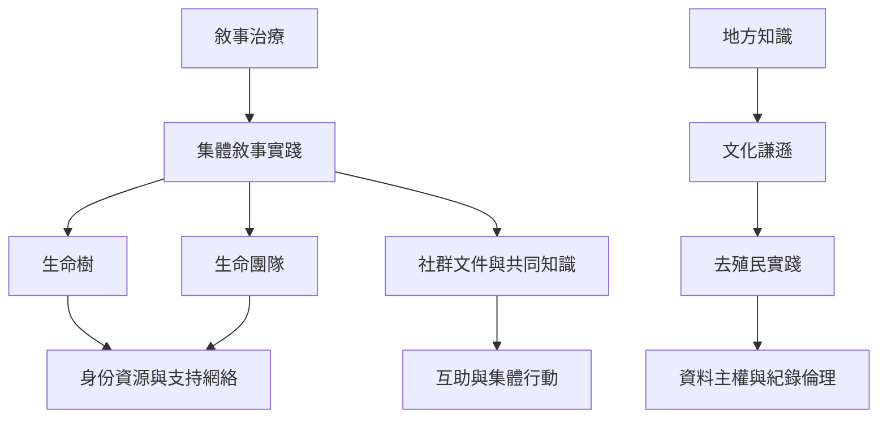

本地圖將敘事工作由個別會談延伸到團體、原住民族知識、難民支持與社群互助。跨文化不是把西方方案原封不動搬到其他地區，而是讓地方語言、關係結構、歷史與知識治理共同塑造介入。核心條目包括 [[集體敘事實踐]]、[[生命樹]]、[[生命團隊]]、[[文化謙遜]]、[[去殖民實踐]] 與 [[地方知識]]。

跨地區材料：[[香港長者生命樹團體試驗顯示生命智慧可被重新辨認]]、[[生命樹為難民青少年提供先談根與資源再談創傷的集體敘事路徑]]、[[毛利知識與雙文化教育可讓敘事治療重新檢視知識權力]]、[[台灣跨文化伴侶案例讓地方信仰與原住民族身份進入敘事治療]]、[[墨西哥城的女性主義去殖民照顧空間把敘事倫理帶進社群組織]]、[[美國LGBTQ有色人種的敘事研究把壓迫重新放入社會脈絡]]。
