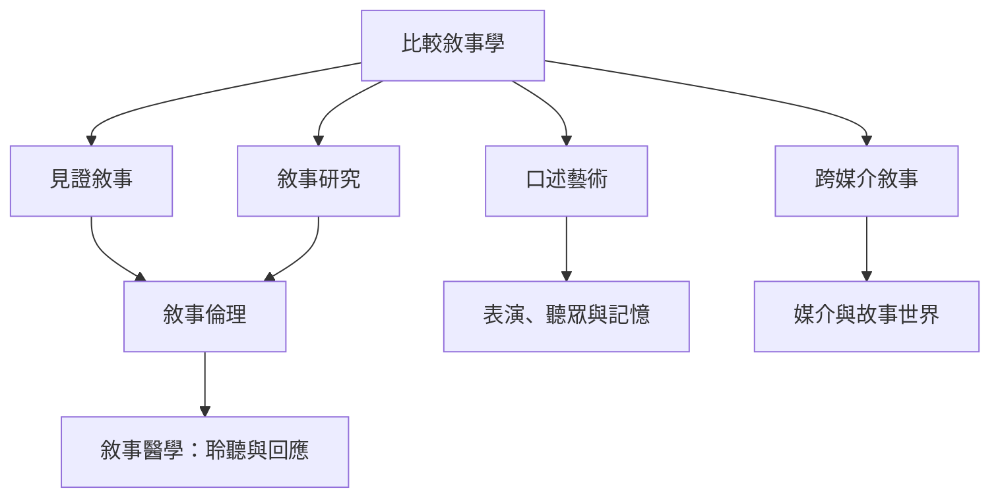

此圖將跨文化敘事理論與口述、見證、跨媒介及照護實踐連接；它不是文化分類表，而是比較問題的入口。

此圖中的概念可沿著不同路徑交叉閱讀：[[口述藝術]]、[[見證敘事]]、[[跨媒介敘事]]、[[敘事醫學]]、[[敘事研究]]、[[敘事倫理]]、[[米克馬克口述史呈現故事作為法律秩序與集體主權的實踐]]、[[口述歷史可以是法律秩序與集體主權的承載方式]]、[[敘事學]]。

* 延伸閱讀：[[Narratology|敘事學導讀]]
