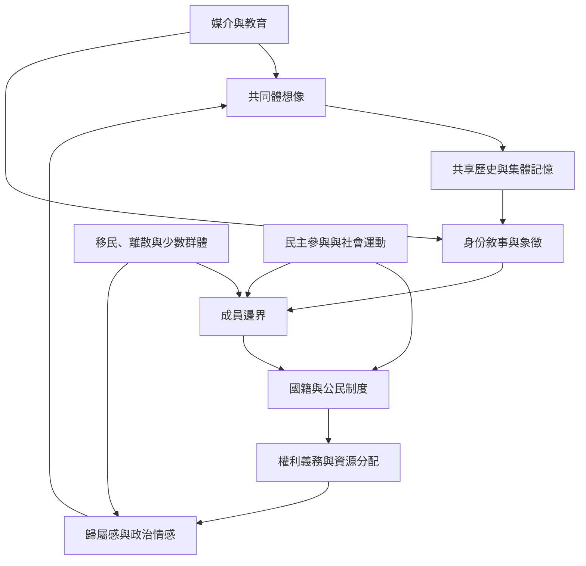

國族認同可從四個互相影響的面向理解：共同體想像、成員邊界、國家制度與個人情感。共同體想像提供共享故事；邊界分類界定誰被視為成員；制度讓分類產生法律與資源後果；情感則使歸屬不只是行政關係。四者不是線性階段，而是持續互相形塑。

延伸閱讀：[[國族共同體是透過歷史敘事與日常實作持續生成的]]、[[媒介讓陌生人得以同步想像共同體]]、[[國族認同是一種關係性分類而非固定本質]]、[[國籍族裔與國族認同是不同層次的歸屬]]、[[國家制度透過標準化創造可治理的國族人口]]、[[法律公民資格不保證社會承認的共同體成員資格]]。

概念：[[國族認同]]、[[民族]]、[[想像的共同體]]、[[集體記憶]]、[[公民身分]]、[[國籍]]、[[國家]]。
