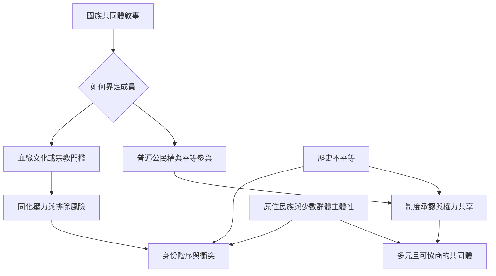

國族認同可以促進公共互助、民主參與與反殖民自決，也可能被用來製造內外之分、要求文化同化或排除少數群體。判斷一種國族敘事是否包容，不能只看它是否使用公民、團結或多元等語言，而要分析成員資格、權力分配、歷史代表、制度平等與少數群體的自我定義權。

深入閱讀：[[公民民族主義與族裔民族主義不是互斥的兩種現實]]、[[國族包容必須檢查權力與資源分配而不只檢查修辭]]、[[原住民族的政治主體性不能被化約為國家文化遺產]]、[[離散與流離失所能以記憶維繫跨境共同體]]。

概念：[[公民民族主義]]、[[族裔民族主義]]、[[多元文化主義]]、[[公民身分]]、[[原住民族]]、[[自決權]]。
