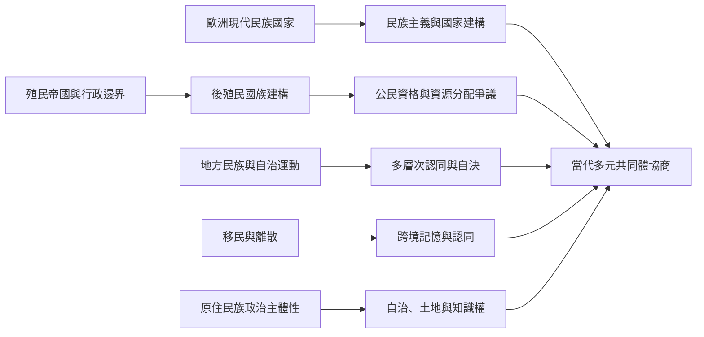

全球國族認同並非單一歐洲模式的複製。印刷文化與現代民族主義、殖民行政邊界、反殖民運動、地方自治、離散記憶、原住民族自決及移民制度，都形成不同歷史路徑。比較的重點不是尋找一種普遍模板，而是辨認各地共同問題與在地差異。

區域案例：[[蘇格蘭魁北克與加泰隆尼亞展示國家內部的多層次國族認同]]、[[迦納公民身分爭議顯示出生權利與本土性想像可能衝突]]、[[日本同質性敘事可能遮蔽國籍與文化歸屬的多樣性]]、[[南非彩虹國族的包容語言仍可能掩蓋社會不平等]]、[[拉丁美洲原住民族的國族敘事挑戰單一國家起源神話]]、[[巴勒斯坦離散記憶讓國族認同超越領土邊界]]。

概念：[[後殖民主義]]、[[自決權]]、[[離散]]、[[原住民族]]、[[次國家認同]]、[[民族國家]]。
