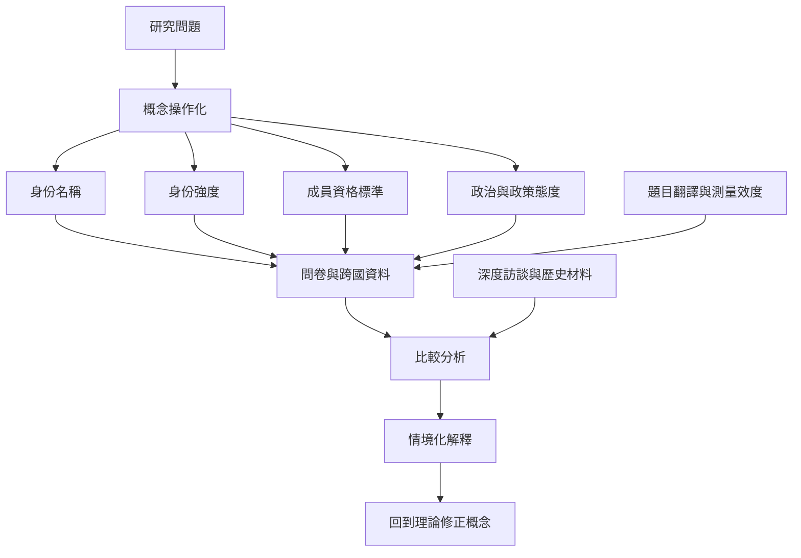

國族認同研究需要把概念拆開：身份名稱、認同強度、成員資格標準、國族自豪感、情感連結、制度信任、移民態度與政策偏好。量化調查能提供比較資料，但必須閱讀題目、抽樣、翻譯與時點；質性訪談則能補足身份如何在生活情境中被理解和使用。

核心材料：[[ISSP二〇二三國族認同與公民身分資料提供跨國比較基礎]]、[[台灣人與中國人認同的長期趨勢必須連同調查方法閱讀]]、[[國族認同問卷的題目設計會改變研究者看到的身份結構]]。

延伸行動：[[把國族認同研究從你是誰轉為誰在何時如何分類你]]、[[建立一份多重歸屬訪談地圖而不是單選身份表]]、[[比較各國國族認同時先建立共同測量矩陣]]。

概念：[[國族認同]]、[[公民身分]]、[[國籍]]、[[次國家認同]]。
