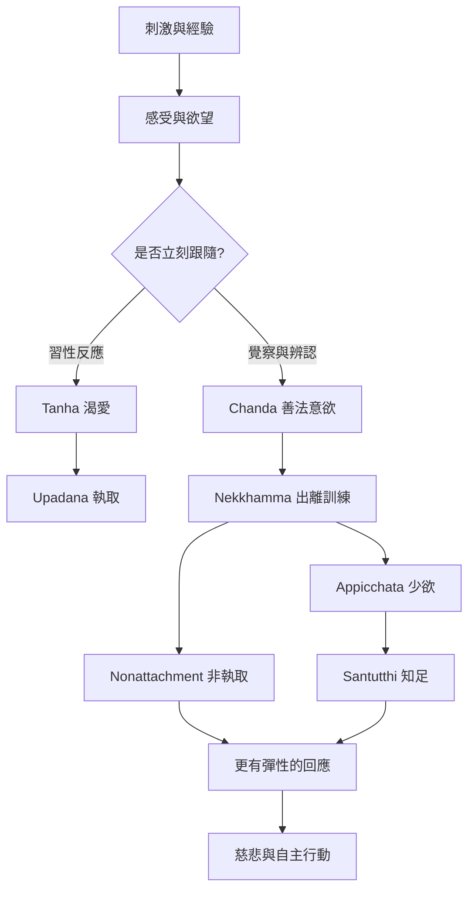

本圖將出離放進日常心理歷程：欲望生起後，不必立刻壓抑或服從，而可以透過覺察、辨認因果、建立選擇距離，再回應當下需要。現代心理學的非執取與自願簡樸提供可比較的研究視角，但不能取代佛教解脫論。

連結：[[Nekkhamma_出離]]、[[Tanha]]、[[Chanda]]、[[Upadana]]、[[Nonattachment]]、[[Appicchata]]、[[Santutthi]]、[[Voluntary_simplicity]]、[[Middle_Way]]。

## 參考
* [[非執取量表把不執著轉為可測量的心理構念]]；[[非執取與福祉的關聯受到研究支持但因果尚未確立]]；[[自願簡樸與福祉呈現正向關聯但效果依情境而異]]。
* [[正確的出離不是壓抑而是看清選擇成本]]；[[在家修行可用小尺度戒取實驗培養出離]]。

導讀：[[Nekkhamma]]。
