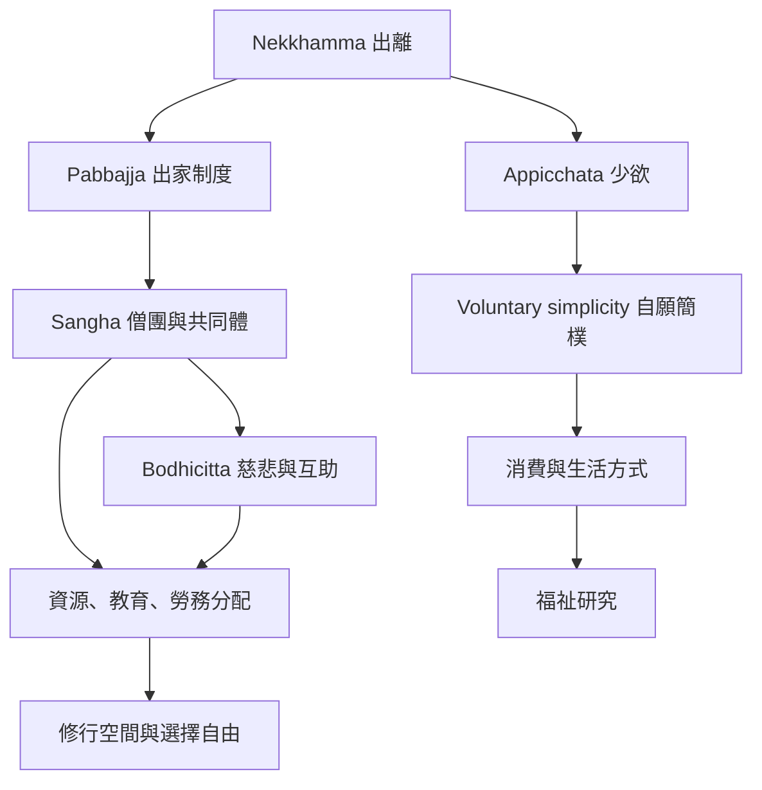

出離不只是一種個人心理狀態，也涉及支持修行的社群、制度、財物與勞務分配。本圖將出家制度、女性修行者經驗和自願簡樸研究放在同一張圖上，避免把所有簡化生活的方式都視為同一種修行。

連結：[[Nekkhamma_出離]]、[[Pabbajja]]、[[Sangha]]、[[Appicchata]]、[[Voluntary_simplicity]]、[[Bodhicitta]]。

## 參考
* [[泰國女性出家者的歷史顯示修行空間也受制度形塑]]；[[斯里蘭卡與藏傳女性出家者的生命不能被單一解放敘事概括]]；[[自願簡樸與福祉呈現正向關聯但效果依情境而異]]。

導讀：[[Nekkhamma]]。
