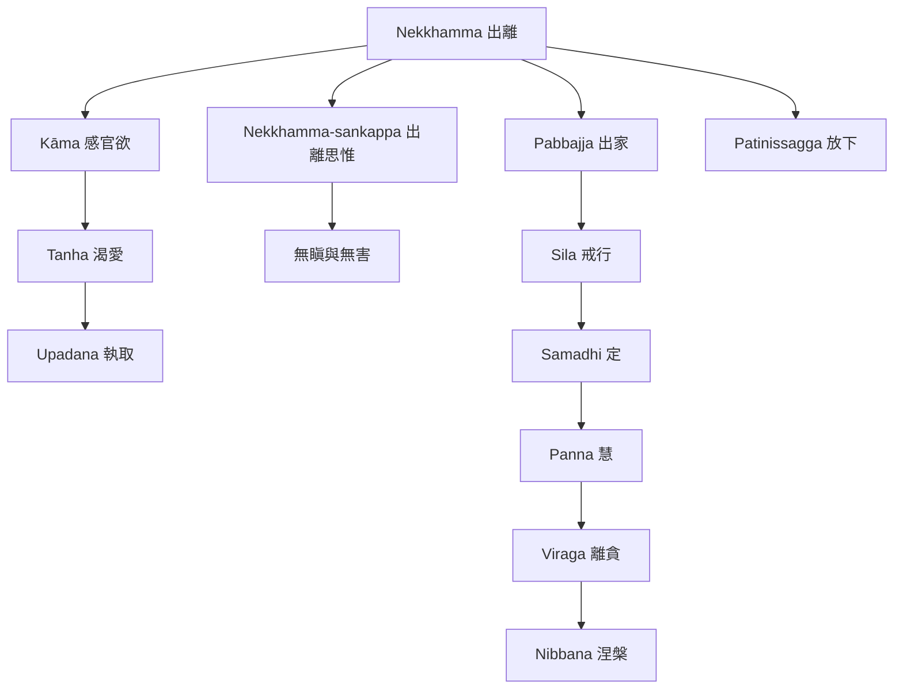

本圖整理 nekkhamma 從語義、感官欲、正思惟到出家與解脫的概念層次。要避免將外在出家、心理上的離欲與究竟解脫混為一談。

連結：[[Nekkhamma_出離]]、[[Nekkhamma-sankappa]]、[[Kama]]、[[Tanha]]、[[Upadana]]、[[Pabbajja]]、[[Sila]]、[[Samadhi]]、[[Panna]]、[[Viraga]]、[[Patinissagga]]。

## 參考
* [[正思惟以離欲無瞋與無害構成]]；[[離欲是感官欲樂的出路並指向禪定之樂]]；[[出家提供修習梵行的環境但不等於解脫]]。

導讀：[[Nekkhamma]]。
