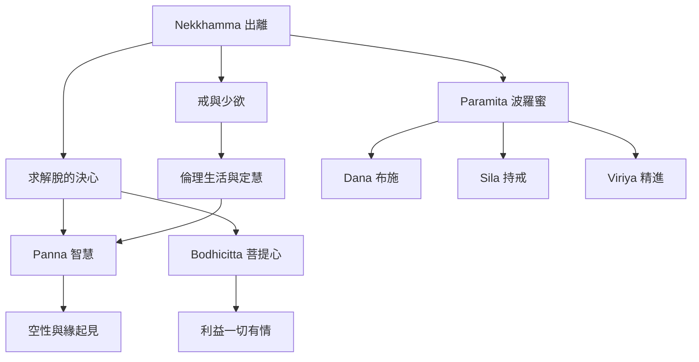

本圖比較上座部的正思惟與十波羅蜜脈絡，以及藏傳道次第的出離、菩提心與空性智慧三要。這些傳統在術語架構上不同，但都把出離視為鬆動欲望與輪迴執取的修行方向。

連結：[[Nekkhamma_出離]]、[[Paramita]]、[[Bodhicitta]]、[[Panna]]、[[Dana]]、[[Sila]]、[[Viriya]]。

## 參考
* [[十波羅蜜清單呈現上座部菩薩道的長程修習]]；[[藏傳道次第以出離菩提心與空性智慧統攝修道]]；[[出離需要以慈悲承接對他人的責任]]。

導讀：[[Nekkhamma]]。
