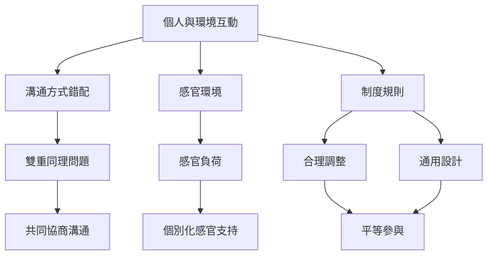

本地圖將障礙理解為個人特質與環境、制度及人際互動共同形成的結果。從雙重同理、感官環境到合理調整，可看見支持不應只要求個人改變。

## 概念關係圖

## 概念
* [[雙重同理問題]]
* [[社會模式]]
* [[合理調整]]
* [[通用設計]]
* [[感官處理]]
* [[污名]]

## 延伸筆記
* [[note/個人特質與環境互動共同形成障礙]]
* [[note/溝通困難可能來自神經型態之間的互動錯配]]
* [[note/合理調整是平等參與的條件而不是特權]]
