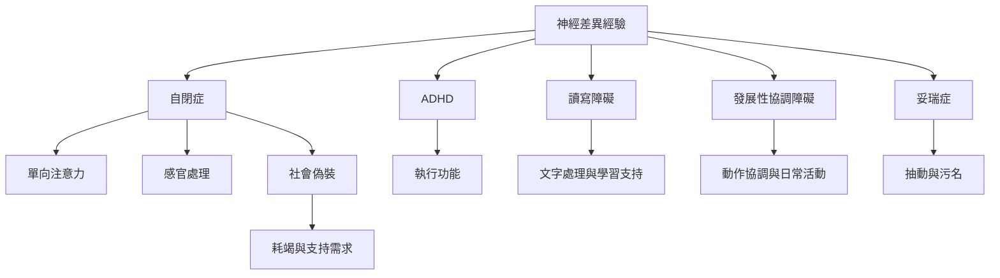

本地圖從不同神經型態的經驗出發，將注意、感官、溝通、偽裝與執行功能等跨診斷議題連結起來。各種神經型態不是同一種經驗的不同名稱，應保留差異與個體變異。

## 概念關係圖

## 概念
* [[單向注意力]]
* [[感官處理]]
* [[社會偽裝]]
* [[自閉症耗竭]]
* [[注意力不足過動症]]
* [[讀寫障礙]]
* [[發展性協調障礙]]
* [[妥瑞症]]
* [[執行功能]]

## 延伸筆記
* [[note/單向注意力能帶來深度投入也會增加切換成本]]
* [[note/感官環境會共同塑造參與與疲憊程度]]
* [[note/偽裝常是對社會壓力的適應而非單純欺瞞]]
