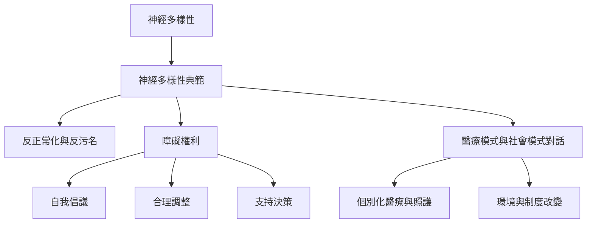

本概念地圖整理神經多樣性從群體差異、社群身份到權利倡議的基本結構。它把反病理化、障礙模式、自我倡議與醫療支持放在同一張圖中，提醒讀者不要把尊重差異誤解為拒絕照護。

## 概念關係圖

## 概念
* [[神經多樣性]]
* [[神經差異者]]
* [[神經典型]]
* [[神經多樣性典範]]
* [[社會模式]]
* [[醫療模式]]
* [[支持決策]]
* [[合理調整]]

## 延伸筆記
* [[note/神經多樣性是一種人類差異而不是單一診斷]]
* [[note/神經多樣性典範要求重新檢視正常標準]]
* [[note/醫療模式與社會模式可以在個別支持中互補]]
* [[note/自主不等於不需要他人支持]]
