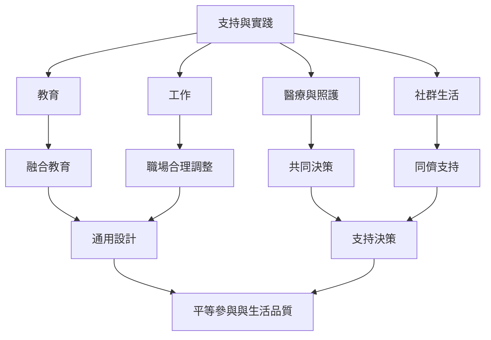

本地圖把權利原則轉換為學校、工作、照護與社群中的實際做法。通用設計提供共同基礎，合理調整回應個別情境，支持決策則確保當事人仍能控制自己的生活。

## 概念關係圖

## 概念
* [[合理調整]]
* [[通用設計]]
* [[融合教育]]
* [[支持決策]]
* [[互賴]]

## 延伸筆記
* [[note/合理調整是平等參與的條件而不是特權]]
* [[note/通用設計與個別支持應互相補充]]
* [[note/自主不等於不需要他人支持]]
