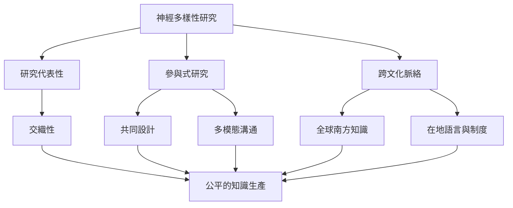

本地圖整理研究如何納入當事人、如何檢查樣本代表性，以及如何避免將歐美研究視為全球普遍經驗。它把交織性、參與式研究與跨文化方法連在一起。

## 概念關係圖

## 概念
* [[交織性]]
* [[參與式研究]]
* [[神經多樣性]]
* [[支持決策]]

## 延伸筆記
* [[note/交織性決定神經差異者面對的障礙如何累積]]
* [[note/研究代表性是知識公平的一部分]]
* [[note/研究方法應配合參與者而非要求參與者配合方法]]
* [[note/英語出版物不能代表全球神經差異經驗]]
