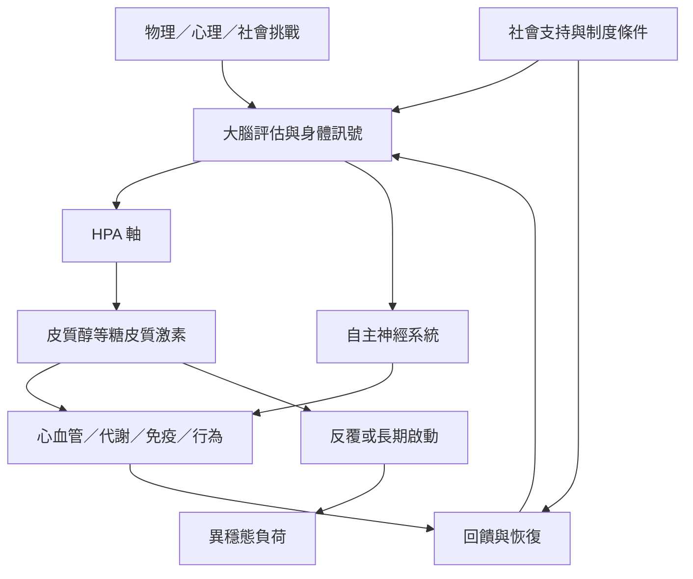

壓力反應是大腦、HPA 軸、自主神經、免疫、代謝與行為的協作。異穩態描述短期因應挑戰的適應性變化；當系統長期或反覆承受調節需求，可能出現異穩態負荷。社會條件會影響壓力暴露與恢復機會。

圖中「壓力源」不只包含個人事件，也包含可避免的制度性暴露。閱讀時可連結[[壓力反應是腦與身體雙向協調的過程]]、[[異穩態描述身體透過改變來維持穩定]]、[[異穩態負荷是多個生理系統長期調節代價的集合]]與[[社會支持可能緩衝壓力但不能取代結構改革]]。

## 相關概念
* [[下視丘腦下垂體腎上腺軸]]、[[皮質醇]]、[[異穩態]]、[[異穩態負荷]]、[[糖皮質激素受體]]、[[社會決定因素]]。
