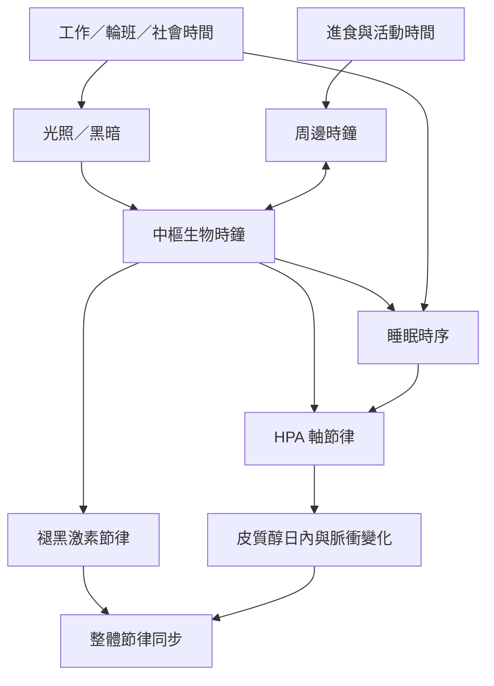

神經內分泌訊號具有時間結構。中樞時鐘與外界光暗同步，並影響皮質醇、褪黑激素及其他生理節律；睡眠、輪班、時差、進食與活動也會改變節律同步情況。分析荷爾蒙必須看採樣時間與完整節律，而非只看單一數值。

建議從[[晝夜節律使荷爾蒙測量必須考慮時間]]開始，並連結[[輪班工作會使生理時鐘與社會時間錯位]]、[[神經內分泌功能會受到晝夜節律與內在時鐘調控]]及[[荷爾蒙濃度必須放回日內節律與脈衝模式解讀]]。

## 相關概念
* [[晝夜節律]]、[[超日節律]]、[[褪黑激素]]、[[皮質醇]]、[[下視丘腦下垂體腎上腺軸]]。
