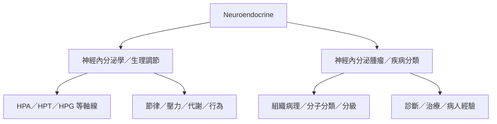

「神經內分泌」在文獻中至少有兩個不同層次：其一是研究神經與荷爾蒙如何協調生理的學科；其二是病理學中描述一類具有神經內分泌分化特徵的腫瘤。兩者共享術語，但研究問題、證據類型和專業用途不同。

檢索資料時先確認作者使用的語境。可從[[神經內分泌腫瘤是疾病分類而非整個神經內分泌研究領域]]與[[世界衛生組織二〇二五年分類將內分泌與神經內分泌腫瘤納入國際標準]]開始，再延伸至病友敘事。

## 相關概念
* [[神經內分泌學]]、[[神經內分泌腫瘤]]、[[神經內分泌系統]]、[[醫療知識需要與患者生活經驗共同構成理解]]。
