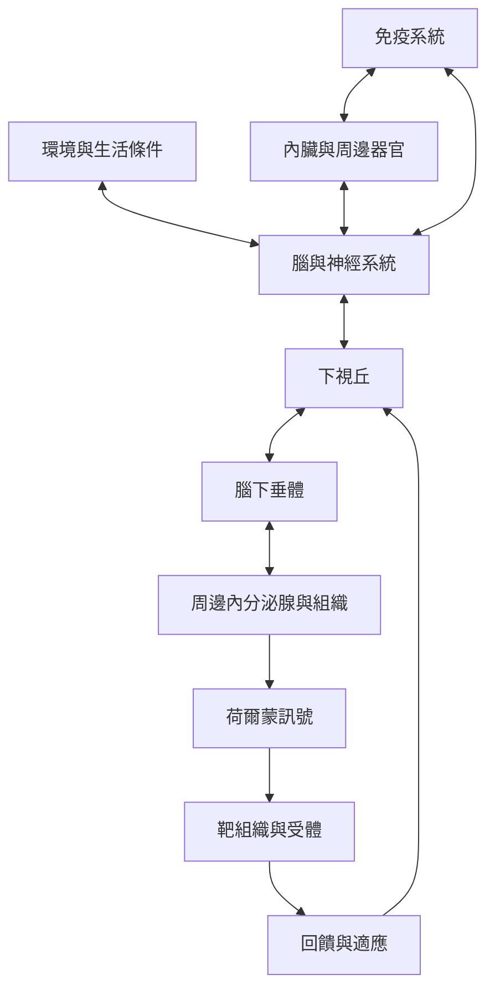

神經內分泌學研究神經系統、內分泌系統與身體器官如何交換訊號。最基本的骨架是下視丘整合資訊、腦下垂體調節周邊腺體，以及激素受體與回饋機制；但腸道、脂肪組織、免疫細胞與其他器官也會直接參與訊號網絡。

概念地圖應將它理解為雙向網絡，而非線性命令鏈。可從[[神經內分泌系統是身體內外資訊互通的調節網絡]]開始，再閱讀[[下視丘是神經與內分泌資訊整合的重要節點]]、[[神經內分泌反應依賴回饋而非單向命令]]與[[神經免疫連結圖譜將腦與免疫系統視為雙向網絡]]。

## 相關概念
* [[神經內分泌學]]、[[神經內分泌系統]]、[[內分泌系統]]、[[下視丘]]、[[腦下垂體]]、[[荷爾蒙]]、[[神經免疫互動]]、[[內感受]]。
