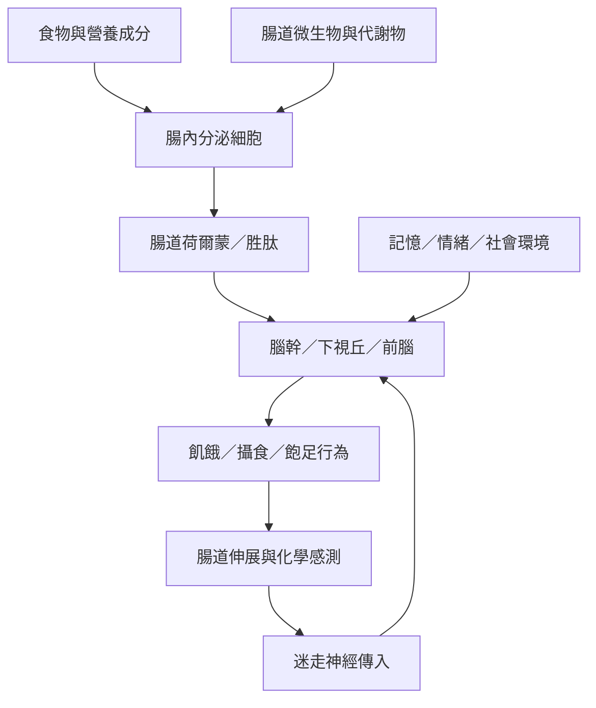

腸道是感測、分泌與神經溝通的器官。腸內分泌細胞回應腸腔中的營養和微生物相關訊號，釋放荷爾蒙；迷走神經將部分內臟訊號傳入腦幹；下視丘與前腦網絡再整合身體狀態、記憶、情緒與食物線索，調節進食行為。

這張圖能將[[腸道腦訊號讓食慾成為身體與環境互動的結果]]、[[腸內分泌細胞是飲食與腸道微生物連接身體訊號的介面]]與[[內感受是身體狀態進入主觀經驗的重要介面]]放在同一個解釋框架中。

## 相關概念
* [[腸腦軸]]、[[腸內分泌細胞]]、[[迷走神經]]、[[內感受]]、[[荷爾蒙]]。
