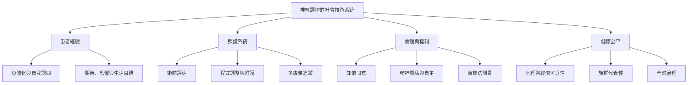

神經調控的成果由技術、患者經驗、照護系統與治理環境共同形成。本圖將身體化、知情同意、資料治理、可近性及長期支持放在同一張圖中。入口概念為[[植入裝置會改變身體感與患者自我敘事]]、[[神經調控可近性是科技治理與健康公平問題]]及[[神經隱私與精神自主必須納入神經調控同意程序]]。

**雙向概念連結：** [[身體化]]、[[自我認同]]、[[共同決策]]、[[知情同意]]、[[神經科技倫理]]、[[健康公平]]、[[醫療可近性]]、[[UNESCO於2025年通過神經科技倫理建議書]]。

## 參考
* [[脊髓刺激長期生活經驗包含裝置身體化與持續照護]]。
* [[DBS患者經驗同時包含生活重獲自主與對裝置的恐懼]]。
* [[不同地區的神經調控可近性受到地理性別種族與社經條件影響]]。
* [[UNESCO於2025年通過神經科技倫理建議書]]。
* [[Neuromodulation]]。
