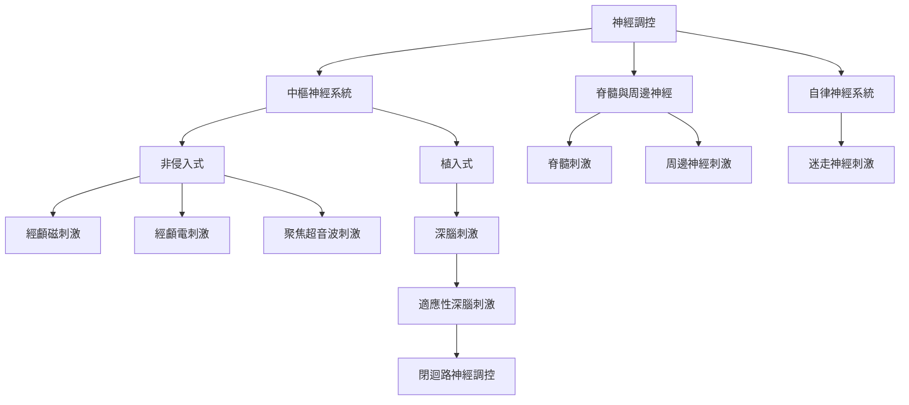

本圖從介入位置與刺激方式整理神經調控技術。中樞、脊髓、周邊及自律神經系統可使用不同刺激方式；非侵入式與植入式是介入路徑的分類，不是療效排序。核心入口為[[神經調控]]、[[神經刺激]]與[[神經調控是改變神經系統活動的介入而非一種單一療法]]。

**雙向概念連結：** [[神經調控]]、[[神經刺激]]、[[深腦刺激]]、[[經顱磁刺激]]、[[經顱電刺激]]、[[迷走神經刺激]]、[[脊髓刺激]]、[[聚焦超音波刺激]]、[[適應性深腦刺激]]、[[閉迴路神經調控]]。

## 參考
* 技術範圍：[[神經調控以調整神經活動而非單純刺激神經為核心]]。
* 綜述：[Neuromodulation techniques – From non-invasive brain stimulation to deep brain stimulation](https://pmc.ncbi.nlm.nih.gov/articles/PMC11103220/)。
* 導讀：[[Neuromodulation]]。
