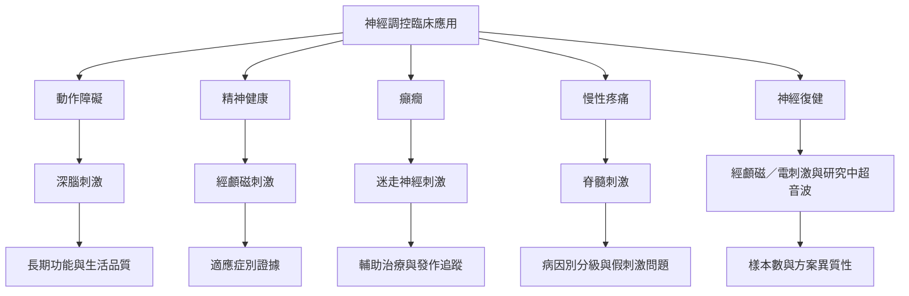

本圖將常見臨床應用與證據判讀連在一起。每種技術都必須回到特定適應症、患者條件、比較組、結果指標與追蹤時間，不可只依設備名稱判斷療效。入口概念為[[臨床證據必須按適應症而非技術品牌分級]]。

**雙向概念連結：** [[深腦刺激]]、[[經顱磁刺激]]、[[迷走神經刺激]]、[[脊髓刺激]]、[[神經生物標記]]、[[假刺激]]、[[系統性回顧]]、[[臨床試驗]]。

## 參考
* [[非侵入式腦刺激已用於多種神經疾病但不同適應症證據不一]]。
* [[DBS對帕金森氏症的長期運動效益不代表所有生活品質指標持續改善]]。
* [[脊髓刺激的證據強度必須依疼痛病因分別判斷]]。
* [[Neuromodulation]]。
