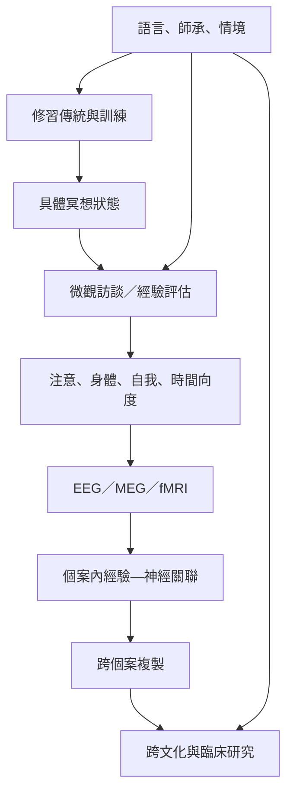

冥想神經現象學以修習者的經驗描述為出發點，研究注意、身體感、自我邊界、吸收與止息等特定經驗如何在時間中改變，並與 EEG、MEG 或 fMRI 指標對照。修習傳統與參與者訓練必須被記錄，否則相似術語可能掩蓋不同實踐。

實證入口：[[冥想中的自我邊界變化與後內側皮質高β活動相關]]、[[禪修止息經驗的EEG研究顯示個案內動態值得分析]]、[[禪定吸收經驗可在單一熟練修習者中進行多模態追蹤]]。研究框架：[[神經現象學式冥想研究正被整理為可銜接臨床的研究綱要]]、[[跨國冥想神經科學聯盟顯示標準化資料共享的重要性]]。

總導讀：[[Neurophenomenology]]。
