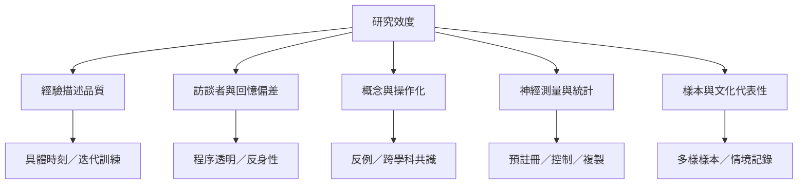

神經現象學研究的效度取決於多層次品質控制：經驗描述是否具體、訪談是否受誘導、概念是否由資料逐步形成、神經測量是否匹配研究問題、分析是否可追蹤，以及結論是否超出樣本與設計能支持的範圍。

閱讀：[[第一人稱報告不是透明的內在讀數而是需要方法校準的資料]]、[[神經現象學研究品質來自概念協作與可重複的實驗程序]]、[[研究品質必須同時處理個案深度與跨樣本推廣性]]、[[跨文化比較必須保留修習脈絡而不是只翻譯經驗詞彙]]。

總導讀：[[Neurophenomenology]]。
