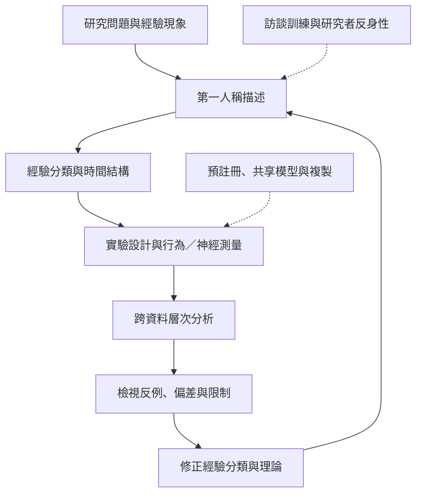

神經現象學研究以具體經驗問題為起點，透過第一人稱描述形成可修正的經驗類別，再與行為及神經測量建立關係，最後讓結果回饋經驗分析與研究設計。核心在循環而非線性地「先訪談、再掃描、最後解釋」。

研究流程依賴[[互相約束]]、[[第一人稱方法]]、[[第三人稱方法]]、[[現象學懸置]]與[[神經動態]]。方法論基礎見[[神經現象學不是把主觀報告附加到腦造影而是建立互相修正的研究循環]]、[[意識研究應把經驗現象的界定放在神經解釋之前]]。

總導讀：[[Neurophenomenology]]。
