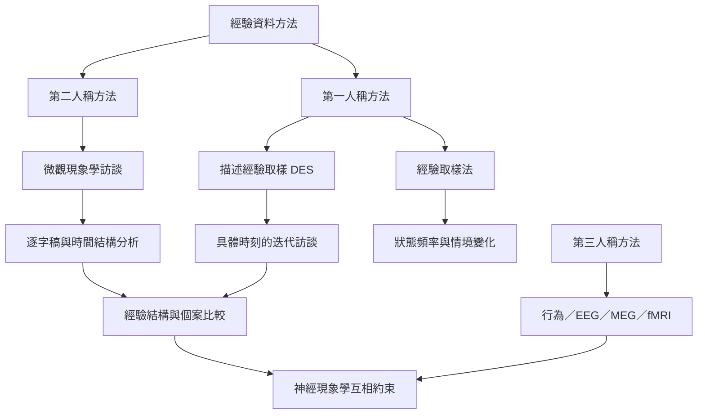

第一人稱方法涵蓋即時或回溯的經驗描述；第二人稱方法則透過訪談者與參與者的互動來細化經驗。微觀現象學、描述經驗取樣與一般經驗取樣彼此相關，但取樣時點、訪談程序與分析目標不同，應依研究問題選擇。

方法概念：[[第一人稱方法]]、[[第二人稱方法]]、[[第三人稱方法]]、[[微觀現象學]]、[[描述經驗取樣]]、[[經驗取樣法]]。方法限制：[[第一人稱報告不是透明的內在讀數而是需要方法校準的資料]]、[[研究者必須把訪談者效應視為資料生成的一部分]]。

總導讀：[[Neurophenomenology]]。
