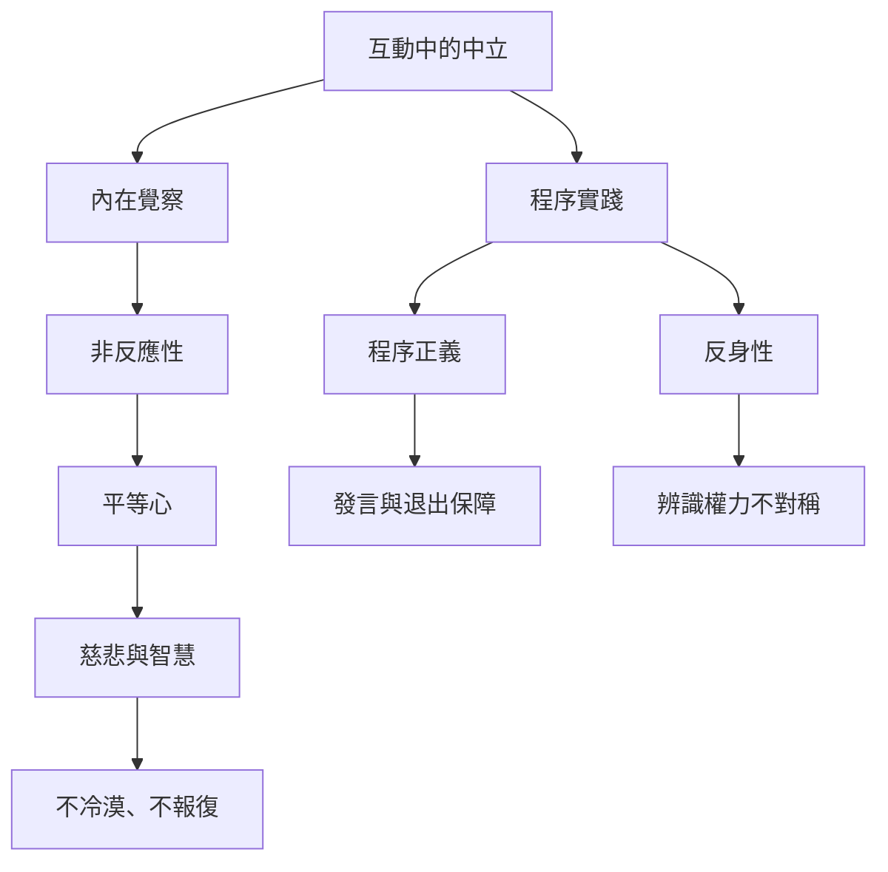

在日常互動與內在修習中，中立不是壓抑情感，而是降低偏愛、厭惡與身份認同對判斷的支配，同時保留慈悲、界線與責任。調解場景提醒我們，個人無法脫離權力位置；內觀修習則提供在反應生起時停頓、觀察與選擇回應的能力。兩者可由[[平等心]]、[[慈悲]]、[[程序正義]]與[[權力不對稱]]連接。

## 思與行
* 練習在立場被挑戰時先覺察反應，再決定如何回應；清明不等於沉默。
* 設計討論程序時，不只問主持人是否偏袒，也問各方是否真的有能力安全地參與。

## 參考
* [[佛教平等心是有慈悲的非反應性而不是情感冷漠]]；[[調解者無法脫離權力位置但能實踐反思性中立]]；[[調解中立必須面對權力不對稱]]；[[平等心不是冷漠而是帶著慈悲的穩定覺察]]。
