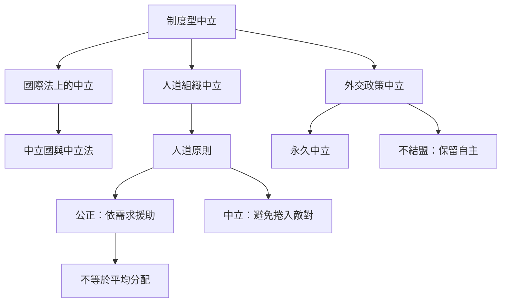

制度型中立處理國家、組織或專業角色與衝突各方的關係；其目的通常不是沒有價值，而是保有信任、法律地位與有效行動空間。必須同時區分[[中立性]]、[[中立國]]、[[中立法]]、[[不結盟運動]]，以及面向受助者需求的[[公正性]]與[[人道主義]]。

## 思與行
* 用本地案例練習辨識：宣稱中立的是國家、組織還是個人？它希望保有什麼信任或空間？
* 將中立與公正分開評估，避免以「沒有偏袒」替代對實際需要的回應。

## 參考
* [[紅十字會的中立是維持人道接觸的手段而不是價值終點]]；[[公正與中立分工才能避免把不選邊誤作公平]]；[[國際法中的中立是非交戰國在特定武裝衝突中的法律地位]]；[[瑞士中立是歷史形成且持續協商的外交工具]]；[[萬隆會議與不結盟運動追求的是去殖民自主而非被動中立]]。
