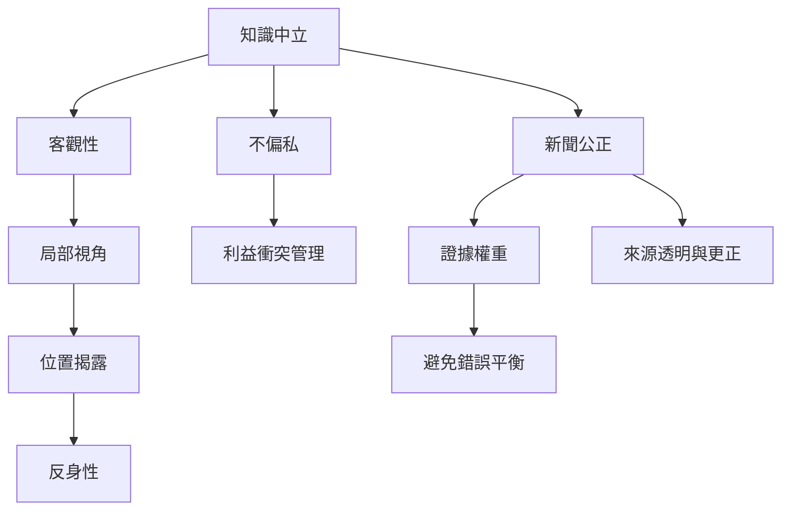

知識生產中的中立，涉及研究者能否避免未經檢查的偏見、如何呈現不同證據，以及如何公開自身視角與限制。此處的核心不是「沒有觀點」，而是[[客觀性]]、[[認識論位置]]與[[反身性]]如何讓主張可以被檢驗。新聞報導尤其需要區分公平與[[錯誤平衡]]。

## 思與行
* 將「中立」的評估轉成研究方法：來源多樣、方法清楚、反例可見、利益可揭露。
* 在新聞與知識整理中，避免將證據不足的少數主張與高可信證據對稱呈現。

## 參考
* [[知識的客觀性來自承認局部視角而非假裝全知]]；[[新聞公正要求依證據給予觀點權重而非機械式兩邊平衡]]；[[道德不偏私必須說明對誰以及在哪個面向不偏私]]；[[中性語言會影響人們在想像中看見哪些群體]]。
