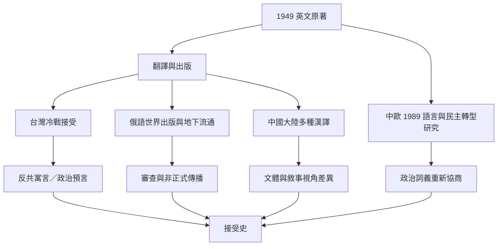

《一九八四》的跨文化生命並非單向輸出：譯者、出版社、政治制度、讀者與學術研究共同改變它的意義。台灣冷戰時期的反共定位、俄語世界的地下流通、中歐政治語言轉型，以及中國大陸不同譯本的文體差異，構成可比較但不可互相簡化的案例。

核心連結：[[翻譯與出版副文本會重新框定經典的政治意義]]、[[不同社會會把同一本小說讀成不同政治寓言]]、[[台灣對歐威爾的接受史顯示翻譯會隨冷戰政治立場改變]]、[[俄語世界的《一九八四》流通史包含海外出版與地下傳播]]、[[中國大陸三種《一九八四》漢譯本的比較揭示文體選擇的差異]]、[[接受史]]、[[出版審查]]、[[翻譯研究]]。

## 思與行
* 若要擴充地區研究，優先尋找當地版本書目、譯者訪談、出版檔案與讀者評論，而非只靠英文二手印象。
