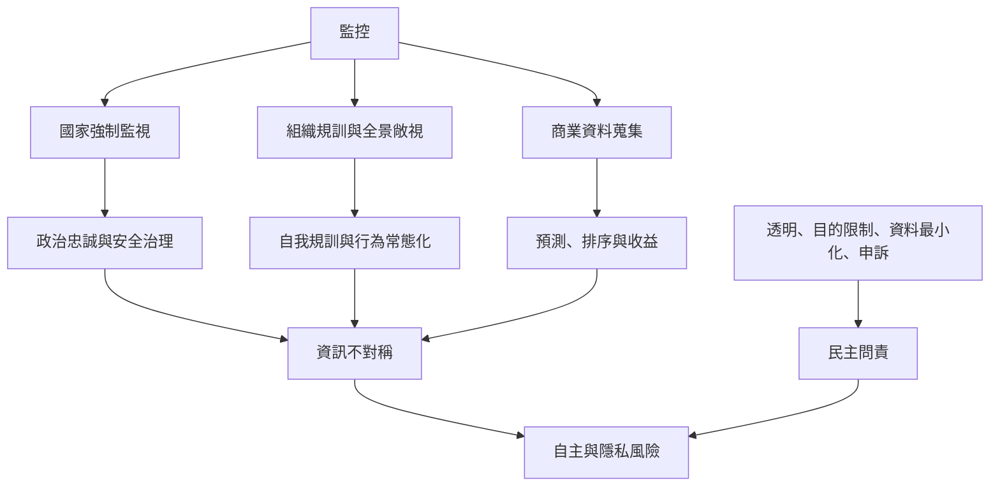

本圖把小說中的電幕、福柯的全景敞視、當代資料監控與監控資本主義放在同一張比較圖中。它們都可能令個人變得可見、可分類與可管理，但權力來源、目的、強制能力及救濟途徑有顯著差異。

核心連結：[[監視的力量來自被觀看的可能性而不只來自實際觀看]]、[[當代監控不只來自國家也來自商業平台]]、[[監控資本主義與極權監控相似但不能直接畫上等號]]、[[全景敞視]]、[[監控]]、[[監控資本主義]]、[[資料治理]]。

## 思與行
* 選擇一個具體組織或數位服務，以資料流、權力差異與救濟途徑做比較。
