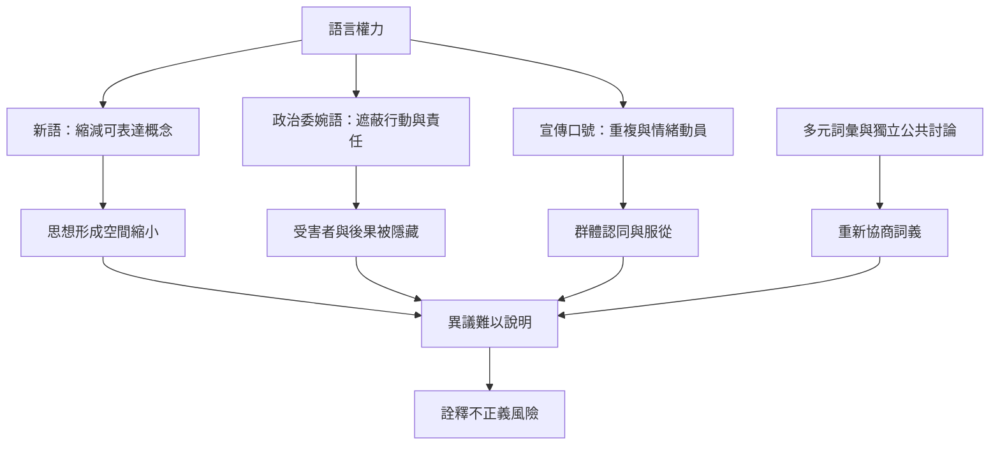

語言控制不只是禁止某些字詞，而是影響人們能否命名經驗、辨認矛盾與形成公共理由。本圖連結新語、政治委婉語、雙重思想與詮釋不正義，並指出語言控制並非必然成功，因為社群可以重新協商詞義並建立其他描述方式。

核心連結：[[新語把思想控制推進到語言能力的層次]]、[[缺乏公共詞彙會使群體經驗難以被理解]]、[[政治委婉語會把責任與受害者從句子中抹去]]、[[《政治與英語》指出模糊語言會降低人們辨認政治暴力的能力]]、[[新語]]、[[雙重思想]]、[[詮釋不正義]]、[[政治宣傳]]。

## 思與行
* 對公共文本進行「行動者—行為—受影響者—證據」拆解，練習辨認語言如何塑造理解。
