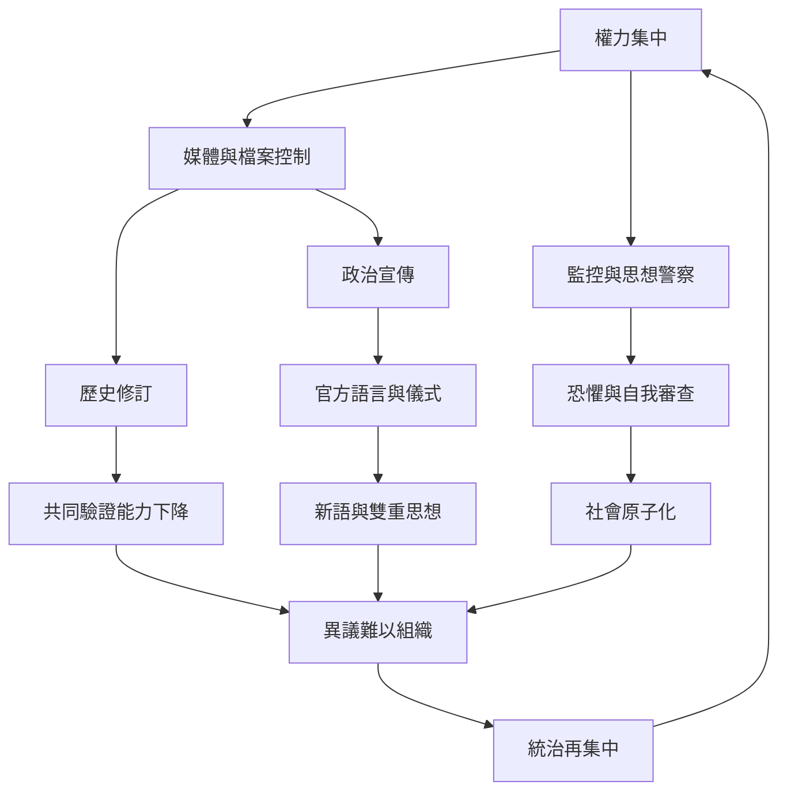

《一九八四》的權力不是單一命令，而是由資訊壟斷、語言規訓、監視、恐懼與社會孤立彼此強化。讀者可從本圖檢視一個統治體系如何使反證難以出現、異議難以連結，最後讓官方版本看似無可替代。

核心連結：[[極權統治必須同時控制資訊與社會關係]]、[[掌控歷史紀錄等於掌控人們驗證現在的能力]]、[[雙重思想讓人同時接受矛盾命題並服從當下權力]]、[[政治委婉語會把責任與受害者從句子中抹去]]、[[反烏托邦]]、[[極權主義]]、[[政治宣傳]]、[[歷史修訂]]。

## 思與行
* 對照真實制度時，逐項檢查資訊壟斷、司法制衡、媒體獨立與公民組織，而非僅憑單一相似情節下結論。
