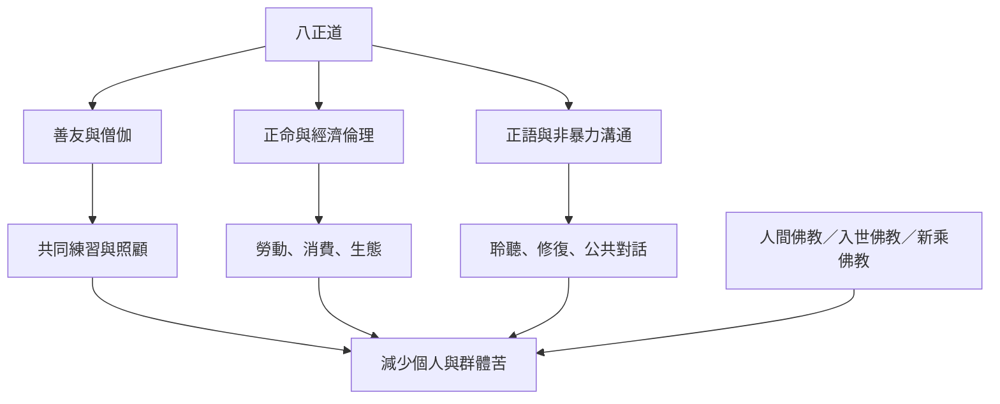

八正道的社會實踐可以從善友、共同照顧、正命、入世佛教與社會正義理解。這張地圖不宣稱所有佛教傳統都採取相同社會路線，而是展示經典資源如何被不同地區和現代行動者重新運用。

## 思與行
* 把每項社會倡議標示其歷史傳統、服務對象、權力結構與實際成果。
* 讓個人修習與制度改革互相支持，並保留不同傳統對解脫與公共責任的差異。

## 參考
* [[善友是修行環境而不是社交裝飾]]、[[入世佛教把個人修行延伸為回應集體苦難]]、[[八正道的社會意義需要同時檢視制度與個人行動]]。
* 概念：[[善友]]、[[入世佛教]]、[[人間佛教]]、[[佛教經濟學]]、[[社會正義]]。
