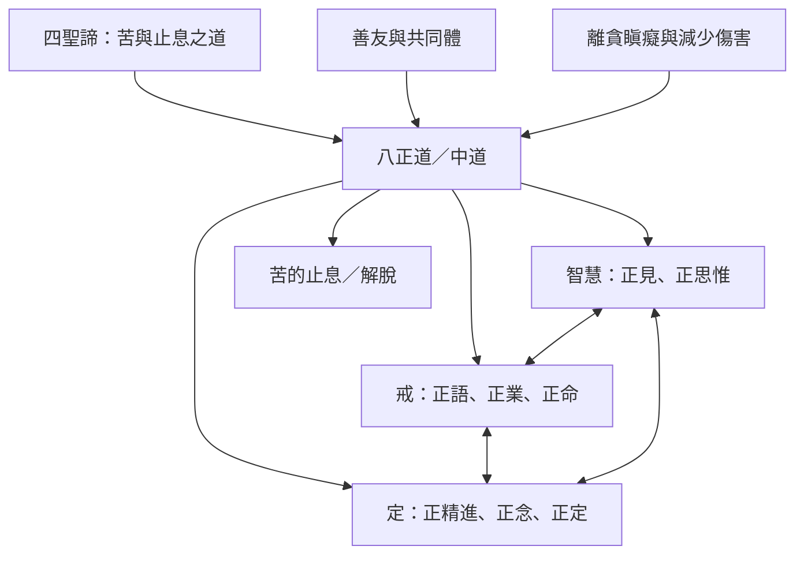

八正道是由八個互相滋養的修行因素構成的完整道路。常見的三學分類有助於理解功能：智慧釐清方向，戒把理解落實在人際與生計，定培育穩定而清明的心。這個分類是讀書地圖，不表示八支只屬於單一區塊。

閱讀這張圖時，請將雙向箭頭理解為互相支持，不是固定因果公式。八正道既是個人修行，也是關係與生活方式的整體檢查。

## 思與行
* 閱讀路徑可由[[智慧倫理與定的三學地圖]]進入，再按生活情境選讀各支分。
* 當某一支分變得困難，先找出其與其他支分的關係，不急著單點責備自己。

## 參考
* 核心：[[八支彼此滋養而不是線性完成的八個階段]]、[[三學把八正道整理成智慧倫理與定的互補訓練]]。
* 原典：[[初轉法輪把八正道定位為離開兩種極端的中道]]、[[相應部四十五點八逐項定義八支聖道]]。
