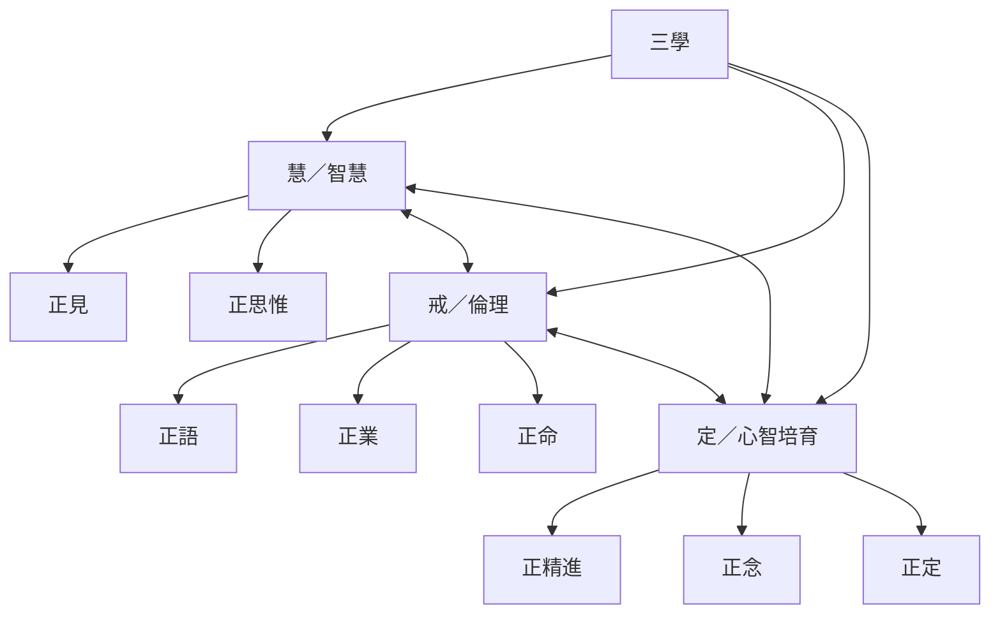

三學把八正道整理成三種相互依存的培育：智慧使人理解苦與因果；戒將理解轉化為減少傷害的語言、行動與生計；定使心更穩定，支持持續觀察與洞察。

三學可用作課程設計、讀書會架構與生活自我檢視，但不應被誤讀成三個互不相干的修行階段。

## 思與行
* 為每學設計對應的閱讀、實踐與回顧方式，避免只偏重理論或靜坐。
* 以八支為整體，定期檢查是否出現「專注很強但待人刻薄」或「懂得很多卻無法落實」等不平衡。

## 參考
* [[三學把八正道整理成智慧倫理與定的互補訓練]]、[[八正道的整體架構與相互關係]]。
* 概念：[[三學]]、[[智慧]]、[[戒]]、[[定]]。
