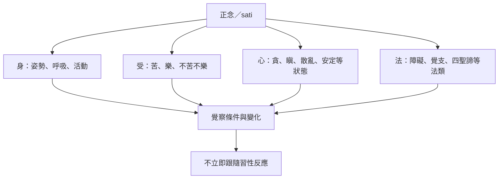

四念處為正念提供四個觀察範圍：身、受、心與法。這種分類幫助練習者將模糊經驗拆解為可觀察的不同面向，而不是把所有感受和念頭都混成「我」或「情緒」。

## 思與行
* 以四個欄位記錄一次重要的情緒經驗，練習區分身體訊號、感受調性、心的狀態與概念內容。
* 在強烈痛苦或創傷反應中，優先確保安全與尋求適當支持，不把正念當成必須獨自承受的要求。

## 參考
* [[念處經以身受心法說明正念的觀察範圍]]、[[正念以身受心法建立完整觀察]]。
* 概念：[[正念]]、[[四念處]]、[[受]]、[[覺察]]。
